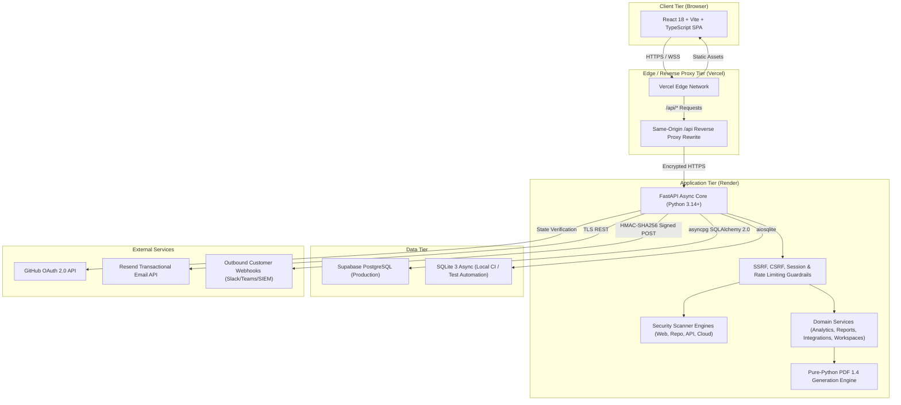

# Sentriq — System Architecture & Technical Design

> **Platform**: Sentriq Application Security Intelligence Platform
> **Repository**: [https://github.com/Induvardhan116/Sentriq.git](https://github.com/Induvardhan116/Sentriq.git)
> **Frontend Target**: [https://sentriq-rouge.vercel.app](https://sentriq-rouge.vercel.app)
> **Backend Target**: [https://sentriq.onrender.com](https://sentriq.onrender.com)
> **Database Engine**: Supabase PostgreSQL (Production) / SQLite Async (Local Development & CI)

---

## 1. High-Level Architecture Topology

---

## 2. Component Design & Modularity

### 2.1 Frontend Client Tier (`frontend/src`)
- **Technology**: React 18.3, TypeScript 5.6, Vite 5.4, Lucide React icons.
- **State Management**: React Context (`AuthContext`) for user session and CSRF token state; local component state for reactive filtering, pagination, and forms.
- **Routing**: Zero-dependency lightweight hash router (`parseRoute`, `routeToHash`, `navigate`) supporting browser history, bookmarks, and deep links without server configuration requirements.
- **Security Posture**:
  - Automatically sends same-origin credentials (`credentials: 'include'`).
  - Transmits anti-CSRF token in `X-CSRF-Token` header for state-mutating requests (`POST`, `PATCH`, `DELETE`).
  - Friendly HTTP 503 handling when production authentication gate is held.

### 2.2 Backend Core (`backend/app`)
- **Framework**: FastAPI with Starlette and Uvicorn.
- **Database Layer**: SQLAlchemy 2.0 Declarative Async ORM.
  - Driver for PostgreSQL: `asyncpg`.
  - Driver for SQLite: `aiosqlite`.
- **Validation & Schemas**: Pydantic v2 schemas enforcing strict typing, bounds checking, and input sanitization.
- **Modular Routers**:
  - `auth.py`: Registration, login, logout, verification, password recovery, GitHub OAuth.
  - `projects.py`: Target lifecycle and authorization confirmation.
  - `scans.py`: Assessment initiation, status tracking, and summaries.
  - `findings.py`: Finding Hub triage, OCC versioning, and immutable audit logs.
  - `analytics.py`: Posture scoring, historical trends, and project leaderboards.
  - `repositories.py`: Code repository connection, SAST, SCA, and masked secret scans.
  - `api_security.py`: OpenAPI 3.0 / Swagger 2.0 ingestion and OWASP API audits.
  - `cloud_security.py`: CIS benchmark CSPM checks for AWS, GCP, and Supabase.
  - `reports.py`: Executive HTML, downloadable PDF 1.4, CSV with BOM, and JSON posture bundle.
  - `settings.py`: Profile updates, password changes, active session revocation, and persisted preferences.
  - `integrations.py`: SSRF-protected webhooks (HMAC-SHA256), scan scheduling, and SIEM CEF events.
  - `workspaces.py`: Multi-tenant organization workspaces, RBAC, and governance audit trails.

---

## 3. Core Security Architecture & Defense-in-Depth

### 3.1 SSRF & Network Isolation (`validator.py`)
- Target URLs submitted for web scanning or outbound webhooks undergo multi-stage validation:
  1. Scheme whitelist: `http`, `https` only (dangerous schemes like `file://`, `gopher://`, `javascript:` fail closed).
  2. Credential rejection: Embedded credentials (`user:pass@host`) are prohibited.
  3. DNS Resolution: Target hostnames are resolved to IP addresses prior to HTTP client dispatch.
  4. Private Network Guardrail: Rejects RFC 1918 subnets (`10.0.0.0/8`, `172.16.0.0/12`, `192.168.0.0/16`), loopbacks (`127.0.0.0/8`), link-local addresses (`169.254.0.0/16`), and cloud metadata services (`169.254.169.254`).

### 3.2 Authentication & Session Lifecycle
- **Password Storage**: Argon2id cryptographic hashing with salt generation; constant-time verification preventing timing side-channel attacks.
- **Session Tokens**: 256-bit entropy generated using `secrets.token_urlsafe(32)`. Only SHA-256 digests (`token_hash`) are persisted in the database; raw tokens are never logged.
- **Session Cookies**:
  - `HttpOnly`: Inaccessible to client JavaScript, mitigating XSS token theft.
  - `SameSite=Lax`: Defends against cross-site request forgery.
  - `Secure`: Forced in production (`Secure=True`) via immutable settings logic.
- **Anti-CSRF Architecture**: Double-submit CSRF token bound to the active session via HMAC-SHA256 using `SECRET_KEY`.

### 3.3 Concurrency Control & Data Immutability
- **Optimistic Concurrency Control (OCC)**: Findings maintain an integer `version` attribute. Updating finding status requires sending `expected_version`. If a concurrent triage change occurred, the backend raises `HTTP 409 Conflict`.
- **Database-Level Immutability**: The `finding_status_events` and `workspace_audit_logs` tables have database triggers on PostgreSQL and SQLite that reject `UPDATE` and `DELETE` queries, establishing a tamper-evident audit history.

### 3.4 Zero Credential Leakage
- **Secrets in Source Code**: Repository scanner masks all detected credentials (`AKIA****MPLE`, `ghp_****XXXX`) before persistence.
- **Cloud IAM**: Role ARNs and access keys are masked (`arn:aws:iam::****:role/...`).
- **Web Cookies**: Scanner strictly redacts sensitive cookie values (`name=REDACTED`) in all logs, database records, and UI displays.

---

## 4. Pure-Python Reporting Engine (`pdf_generator.py`)
To ensure high reliability across local, Docker, and Render serverless environments without requiring external C libraries (e.g. `wkhtmltopdf` or `weasyprint`), Sentriq features a standard-compliant PDF 1.4 document compiler written in pure Python:
- Generates binary PDF streams with exact cross-reference tables (`xref`), trailers, font dictionaries, and page trees.
- Produces multi-page executive security reports, vulnerability catalogs, and compliance matrices.
- Supports automatic vertical page breaks, headers, footers with confidential timestamps, and colored severity chips.
