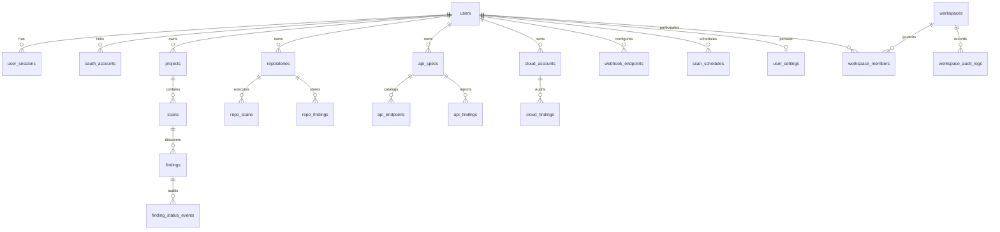

# Sentriq — Database Schema & Data Architecture

> **Engines**: Supabase PostgreSQL (Production) / SQLite Async (Local Testing & CI)
> **ORM**: SQLAlchemy 2.0 Async Declarative Models
> **Driver**: `asyncpg` (PostgreSQL) / `aiosqlite` (SQLite)
> **Migration Engine**: Idempotent programmatic migrations (`backend/app/database/migrations.py`)

---

## 1. Entity-Relationship Overview



---

## 2. Table Schemas & Data Dictionary

### 2.1 Identity & Session Tables
- **`users`**:
  - `id`: `VARCHAR(36)` PRIMARY KEY (UUID).
  - `email`: `VARCHAR(255)` UNIQUE NOT NULL (Index).
  - `hashed_password`: `VARCHAR(255)` (Argon2id or Bcrypt hash).
  - `full_name`: `VARCHAR(255)`.
  - `is_active`: `BOOLEAN` NOT NULL DEFAULT TRUE.
  - `is_verified`: `BOOLEAN` NOT NULL DEFAULT FALSE.
  - `is_superuser`: `BOOLEAN` NOT NULL DEFAULT FALSE.
  - `failed_login_attempts`: `INTEGER` NOT NULL DEFAULT 0.
  - `locked_until`: `TIMESTAMPTZ` (Index).
- **`user_sessions`**:
  - `id`: `VARCHAR(36)` PRIMARY KEY.
  - `user_id`: `VARCHAR(36)` REFERENCES `users(id)` ON DELETE CASCADE.
  - `token_hash`: `VARCHAR(64)` UNIQUE NOT NULL (Index).
  - `ip_address`: `VARCHAR(45)`.
  - `user_agent`: `VARCHAR(512)`.
  - `expires_at`: `TIMESTAMPTZ` NOT NULL (Index).
  - `revoked_at`: `TIMESTAMPTZ` (Index).
- **`oauth_accounts`**:
  - `id`: `VARCHAR(36)` PRIMARY KEY.
  - `user_id`: `VARCHAR(36)` REFERENCES `users(id)` ON DELETE CASCADE.
  - `provider`: `VARCHAR(50)` NOT NULL.
  - `provider_user_id`: `VARCHAR(255)` NOT NULL.
  - Constraint: `UNIQUE(provider, provider_user_id)`.
- **`oauth_states`**:
  - `id`: `VARCHAR(36)` PRIMARY KEY.
  - `state_hash`: `VARCHAR(64)` UNIQUE NOT NULL (Index).
  - `nonce`: `VARCHAR(64)` NOT NULL.
  - `redirect_path`: `VARCHAR(512)` DEFAULT '/overview'.
  - `expires_at`: `TIMESTAMPTZ` NOT NULL.
  - `consumed_at`: `TIMESTAMPTZ` (One-time use guardrail).
- **`user_settings`**:
  - `id`: `VARCHAR(36)` PRIMARY KEY.
  - `user_id`: `VARCHAR(36)` REFERENCES `users(id)` ON DELETE CASCADE UNIQUE.
  - `scanner_timeout_seconds`: `INTEGER` DEFAULT 30.
  - `scanner_max_redirects`: `INTEGER` DEFAULT 5.
  - `scanner_verify_ssl`: `BOOLEAN` DEFAULT TRUE.
  - `scanner_strict_headers`: `BOOLEAN` DEFAULT TRUE.
  - `notify_email_scan_completed`: `BOOLEAN` DEFAULT TRUE.
  - `notify_email_critical_finding`: `BOOLEAN` DEFAULT TRUE.
  - `notify_webhook_enabled`: `BOOLEAN` DEFAULT TRUE.
  - `default_scan_cadence`: `VARCHAR(32)` DEFAULT 'weekly'.
  - `session_timeout_minutes`: `INTEGER` DEFAULT 10080.

### 2.2 Projects & Scans
- **`projects`**:
  - `id`: `VARCHAR(36)` PRIMARY KEY.
  - `owner_id`: `VARCHAR(36)` REFERENCES `users(id)` ON DELETE CASCADE.
  - `name`: `VARCHAR(255)` NOT NULL.
  - `target_url`: `VARCHAR(1024)` NOT NULL.
  - `authorization_confirmed`: `BOOLEAN` NOT NULL DEFAULT FALSE.
  - `created_at`, `updated_at`: `TIMESTAMPTZ`.
- **`scans`**:
  - `id`: `VARCHAR(36)` PRIMARY KEY.
  - `project_id`: `VARCHAR(36)` REFERENCES `projects(id)` ON DELETE CASCADE.
  - `status`: `VARCHAR(32)` NOT NULL (`queued`, `running`, `completed`, `failed`).
  - `overall_score`: `INTEGER` (0–100 posture score).
  - `findings_count`: `INTEGER` DEFAULT 0.
  - `created_at`, `completed_at`: `TIMESTAMPTZ`.

### 2.3 Findings & Tamper-Evident Audit Trails
- **`findings`**:
  - `id`: `VARCHAR(36)` PRIMARY KEY.
  - `scan_id`: `VARCHAR(36)` REFERENCES `scans(id)` ON DELETE CASCADE.
  - `title`: `VARCHAR(255)` NOT NULL.
  - `severity`: `VARCHAR(32)` (`critical`, `high`, `medium`, `low`, `informational`).
  - `category`: `VARCHAR(64)` (`TLS`, `Headers`, `Cookies`, `CORS`, `Exposure`, `Config`).
  - `risk_score`: `INTEGER` NOT NULL.
  - `status`: `VARCHAR(32)` DEFAULT 'open' (`open`, `in_progress`, `resolved`, `false_positive`, `accepted_risk`).
  - `version`: `INTEGER` DEFAULT 1 NOT NULL (Optimistic Concurrency Control).
  - `justification`: `TEXT` (Mandatory for risk acceptance or false positives).
- **`finding_status_events`** (IMMUTABLE AUDIT LOG):
  - `id`: `VARCHAR(36)` PRIMARY KEY.
  - `finding_id`: `VARCHAR(36)` REFERENCES `findings(id)` ON DELETE RESTRICT.
  - `user_id`: `VARCHAR(36)` REFERENCES `users(id)` ON DELETE RESTRICT.
  - `previous_status`: `VARCHAR(32)` NOT NULL.
  - `new_status`: `VARCHAR(32)` NOT NULL.
  - `justification`: `TEXT`.
  - `created_at`: `TIMESTAMPTZ` NOT NULL DEFAULT CURRENT_TIMESTAMP.

### 2.4 Repository & Code Security
- **`repositories`**: `id`, `owner_id`, `name`, `git_url`, `default_branch`, `posture_score`, `created_at`.
- **`repo_scans`**: `id`, `repo_id`, `commit_hash`, `findings_count`, `posture_score`, `created_at`.
- **`repo_findings`**: `id`, `repo_id`, `scan_type` (`secret`, `sast`, `sca`), `file_path`, `line_number`, `code_snippet` (masked), `severity`, `risk_score`, `status`.

### 2.5 API Security & Specifications
- **`api_specs`**: `id`, `owner_id`, `title`, `version`, `spec_format`, `endpoint_count`, `posture_score`, `raw_spec`, `created_at`.
- **`api_endpoints`**: `id`, `spec_id`, `path`, `method`, `auth_required`, `auth_type`, `summary`.
- **`api_findings`**: `id`, `spec_id`, `owasp_category`, `path`, `method`, `severity`, `risk_score`, `status`.

### 2.6 Cloud Security (CSPM)
- **`cloud_accounts`**: `id`, `user_id`, `provider`, `name`, `account_identifier`, `role_arn_or_ref` (masked), `region`, `posture_score`.
- **`cloud_findings`**: `id`, `account_id`, `service`, `resource_id`, `resource_type`, `benchmark_ref`, `severity`, `risk_score`, `status`.

### 2.7 Integrations & Workspaces
- **`webhook_endpoints`**: `id`, `user_id`, `name`, `target_url`, `secret_token` (masked), `event_types`, `is_active`.
- **`scan_schedules`**: `id`, `user_id`, `target_type`, `target_id`, `target_name`, `frequency`, `last_run_at`, `next_run_at`.
- **`workspaces`**: `id`, `name`, `slug` UNIQUE, `owner_id`, `created_at`.
- **`workspace_members`**: `id`, `workspace_id`, `user_id`, `role` (`owner`, `admin`, `analyst`, `auditor`), `joined_at`.
- **`workspace_audit_logs`**: `id`, `workspace_id`, `actor_id`, `actor_email`, `action`, `resource_type`, `resource_id`, `details`, `created_at`.

---

## 3. Database Triggers & Immutability Guarantees

### PostgreSQL Immutability Trigger
```sql
CREATE OR REPLACE FUNCTION sentriq_prevent_audit_tampering()
RETURNS TRIGGER AS $$
BEGIN
    RAISE EXCEPTION 'Audit records are tamper-evident and permanently immutable.';
END;
$$ LANGUAGE plpgsql;

CREATE TRIGGER trg_no_update_finding_events
BEFORE UPDATE OR DELETE ON finding_status_events
FOR EACH ROW EXECUTE FUNCTION sentriq_prevent_audit_tampering();

CREATE TRIGGER trg_no_update_workspace_audit
BEFORE UPDATE OR DELETE ON workspace_audit_logs
FOR EACH ROW EXECUTE FUNCTION sentriq_prevent_audit_tampering();
```

### SQLite Immutability Trigger
```sql
CREATE TRIGGER IF NOT EXISTS trg_prevent_finding_events_update
BEFORE UPDATE ON finding_status_events
BEGIN
    SELECT RAISE(ABORT, 'Audit log records are immutable');
END;

CREATE TRIGGER IF NOT EXISTS trg_prevent_finding_events_delete
BEFORE DELETE ON finding_status_events
BEGIN
    SELECT RAISE(ABORT, 'Audit log records are immutable');
END;
```
